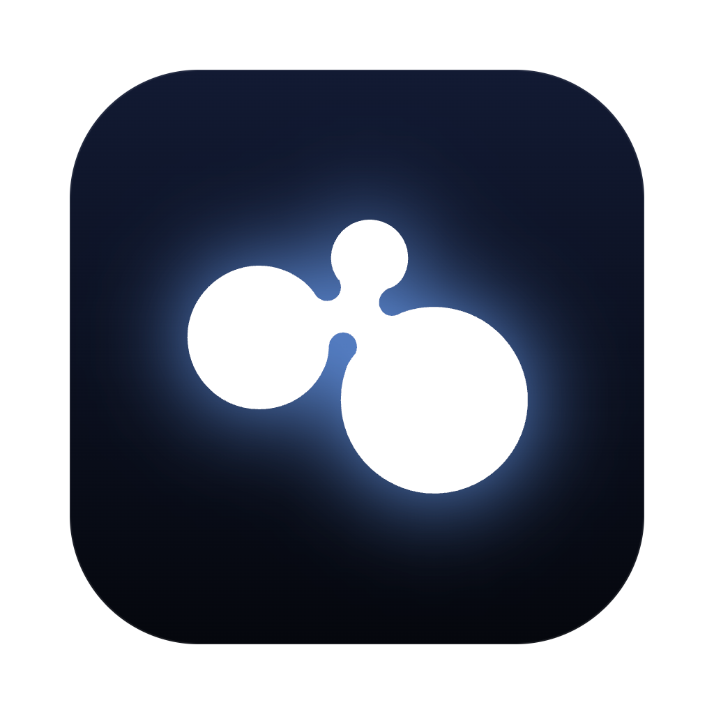
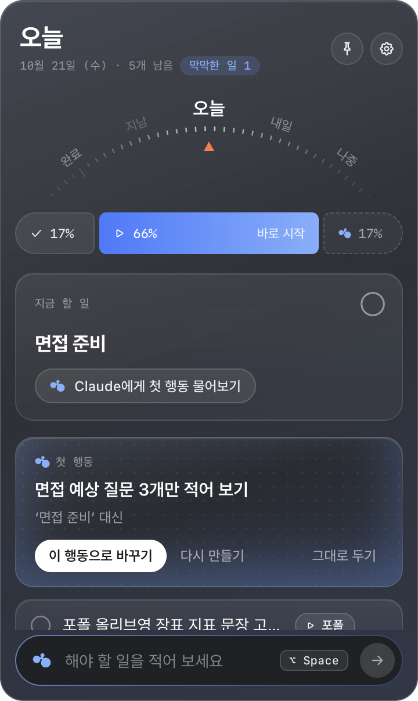
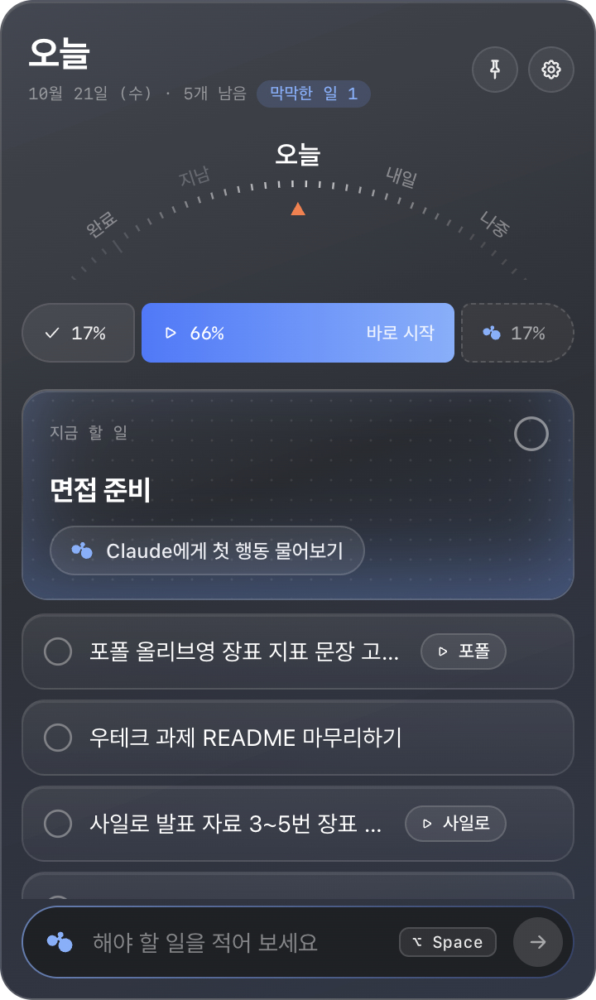
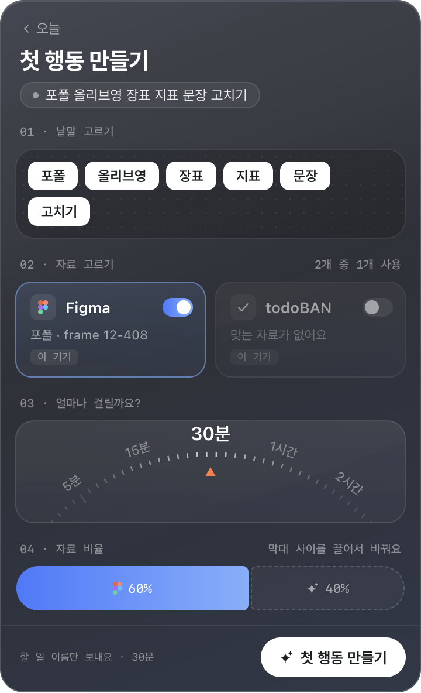
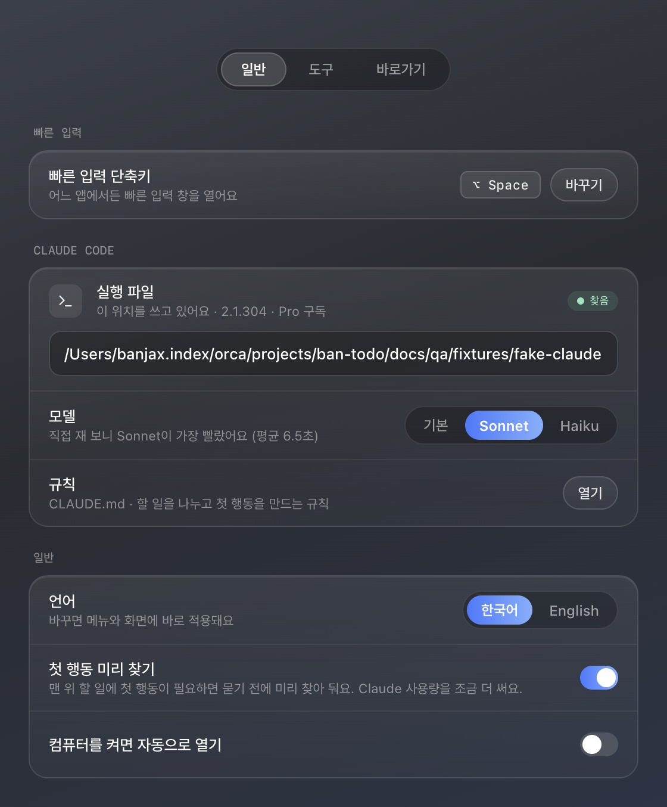

<p align="center">
  
</p>

<h1 align="center">Rigel</h1>

<p align="center">
  해야 하는 건 아는데, 뭐부터 할지 몰라 시작을 못 할 때.<br />
  떠오른 일을 적으면 <b>바로 시작할 첫 행동</b>으로 바꿔 주는 메뉴바 할 일 앱이에요.
</p>

<p align="center"><b>Big task. Blue step.</b> — 가장 뜨거운 별은 발끝에 있어요.</p>

<p align="center">macOS · Windows · 내 Claude 구독으로 동작</p>

<p align="center">
  
</p>

---

## 왜 만들었나요

할 일 목록은 길어지는데, 정작 손이 안 가는 일이 있어요.
'면접 준비', '포트폴리오 정리'처럼 **크고 막막한 일**은 무엇부터 해야 할지 정하는 것부터가 일이라서요.

Rigel은 그 첫 판단을 대신 해 줘요. 할 일을 적는 순간부터 실제로 시작하기까지 거리를 줄이는 게 목표예요.

## 이렇게 써요

### 1. 어디서든 단축키로 적기


- 어느 앱을 쓰고 있든 단축키(맥 `⌥ Space`, 윈도우 `Alt+Shift+Space`)로 빠른 입력 창을 열어요.
- 짧게 적으면 바로 오늘 할 일로 들어가요. `내일 운동`, `금요일까지 보고서`처럼 날짜 말도 알아들어요.
- 길게 적으면 Claude가 할 일 여러 개로 나눠 줘요. 넣기 전에 한 번 확인할 수 있어요.
- `목요일까지 ~하기`는 오늘 할 일로 두고 마감을 목요일로 붙여요. 말하지 않은 마감은 붙이지 않고, 대상이 정해지지 않은 일은 **첫 행동 필요**로 표시해요.

### 2. 메뉴바에서 오늘 할 일 보기



- 맨 위 카드가 **지금 할 일**이에요. 한 화면에 하나만 크게 보여 줘요.
- 위쪽 다이얼을 돌리면 완료 · 지남 · 오늘 · 내일 · 나중 묶음으로 넘어가요.
- 막대는 오늘 할 일 중 끝낸 것, 바로 시작할 수 있는 것, 첫 행동이 필요한 것의 비율이에요.
- 끌어서 순서를 바꾸고, 오른쪽 클릭으로 이름 바꾸기·마감 정하기·옮기기·지우기를 할 수 있어요.

### 3. 막막한 일은 첫 행동으로

막막한 일 옆의 **Claude에게 첫 행동 물어보기**를 누르면, 지금 바로 시작할 수 있는 작고 구체적인 행동 하나를 제안해요.
마음에 들면 할 일 이름이 그 행동으로 바뀌고, 아니면 다시 만들거나 그대로 둘 수 있어요.

- **미리 찾아 둬요.** 맨 위 할 일이 막막하면 묻기 전에 뒤에서 찾아 두어서, 누르자마자 보여요.
- **필요하면 하나만 물어봐요.** "어느 회사 면접이고, 언제인가요?"처럼 답하기 쉬운 질문 하나예요.
- **목록 전체를 보고 정해요.** 같은 목록의 다른 할 일도 함께 봐서, "케이스 하나 더"처럼 대상이 빠진 일도 무엇을 가리키는지 찾고, 다른 할 일과 겹치는 첫 행동은 고르지 않아요.

### 4. 내 자료를 보고 만들기



막막한 할 일을 한 번 누르면 첫 행동을 직접 다듬을 수 있어요.

| 고르는 것 | 설명 |
|---|---|
| 낱말 | 할 일에서 중요한 낱말만 골라요 |
| 자료 | 내 Figma 바로가기, 끝낸 할 일, (맥) 캘린더·최근 문서, Notion·Linear·Figma 프레임(MCP) |
| 크기 | 5분에서 2시간까지. 마감이 가까우면 알아서 작게 잡아요 |
| 비율 | 어떤 자료를 얼마나 참고할지 끌어서 정해요 |

결과에는 **어떤 자료를 참고했는지**가 함께 보이고, 눌러서 Claude가 읽은 문장과 겹친 낱말까지 확인할 수 있어요.

## 설치

### 1. Claude Code 설치하고 로그인하기

Rigel은 **내 컴퓨터의 Claude Code**로 할 일을 나누고 첫 행동을 찾아요. Claude Pro · Max · Team 구독이나 API 키가 필요해요.

1. [Claude Code 설치 안내](https://docs.claude.com/en/docs/claude-code/setup)를 따라 설치해요.
2. 터미널(윈도우는 명령 프롬프트)에서 `claude`를 실행하고 로그인해요.

공식 설치, Homebrew, npm(nvm·volta 포함) 어디에 깔았든 자동으로 찾아요. 못 찾으면 설정에서 위치를 직접 적을 수 있어요.

> 짧은 할 일은 Claude 없이도 적을 수 있어요. 할 일 나누기와 첫 행동 찾기에만 Claude가 필요해요.

### 2. Rigel 받기

**[다운로드 페이지](https://space-angel.github.io/rigel-releases/)**에서 내 컴퓨터에 맞는 버튼을 눌러요.

| 컴퓨터 | 바로 받기 |
|---|---|
| Mac (Apple Silicon) | [Rigel-mac-arm64.dmg](https://github.com/space-angel/rigel-releases/releases/latest/download/Rigel-mac-arm64.dmg) |
| Mac (Intel) | [Rigel-mac-x64.dmg](https://github.com/space-angel/rigel-releases/releases/latest/download/Rigel-mac-x64.dmg) |
| Windows | [Rigel-win-x64-setup.exe](https://github.com/space-angel/rigel-releases/releases/latest/download/Rigel-win-x64-setup.exe) |

아직 서명하지 않은 앱이라 처음 열 때 경고가 떠요. 한 번만 허용하면 돼요.

- **맥**: 앱을 열면 뜨는 창을 닫고, **시스템 설정 → 개인정보 보호 및 보안** 맨 아래의 **그래도 열기**를 눌러요.
- **윈도우**: SmartScreen 창에서 **추가 정보 → 실행**을 눌러요.

새 버전이 나오면 앱이 알아서 확인해요. 윈도우는 다시 켤 때 자동으로 바뀌고, 맥은 설정 → 일반 → 버전에서 **받기**를 누르면 돼요.

### 3. 처음 열면

시작하기 화면이 세 가지를 확인해 줘요.

1. **Claude Code**: 찾았는지, 로그인했는지, 어떤 구독인지
2. **빠른 입력 단축키**: 다른 앱이 쓰고 있지 않은지
3. **자료 연결하기**: 쓸 도구 고르기. Claude에 이미 연결된 Notion · Linear · Figma가 있으면 **켜기** 한 번으로 첫날부터 내 자료를 봐요(나중에 해도 괜찮아요)



### Notion · Linear · Figma 연결하기 (선택)

1. claude.ai → 설정 → 커넥터에서 서비스를 연결해요.
2. 터미널에서 `claude`를 실행하고 `/mcp`를 입력해 로그인해요.
3. Rigel 설정 → 도구에서 켜요. 어느 워크스페이스를 읽는지 확인해서 보여 줘요.

## 내 정보는 어떻게 다루나요

- 할 일과 설정은 **내 컴퓨터에만** 저장돼요(맥 `~/Library/Application Support/todoBAN`, 윈도우 `%APPDATA%\todoBAN`). 앱 이름이 Rigel로 바뀌기 전 폴더 이름을 그대로 써요.
- Claude에는 첫 행동을 정하는 데 필요한 것만 보내요: 할 일 이름과 원래 적은 문장, 같은 목록의 다른 할 일(제목·마감·적은 문장), 고른 낱말, 고른 자료의 이름과 요약. 내 컴퓨터 파일의 내용·링크·위치는 보내지 않아요.
- Notion·Linear·Figma는 Claude Code가 내 계정으로 **읽기만** 해요.
- Rigel은 Claude 계정 정보를 직접 다루지 않아요. 로그인은 Claude Code가 해요.

## 자주 묻는 것

| 이럴 때 | 이렇게 해요 |
|---|---|
| "Claude Code를 찾지 못했어요" | 설치 후 시작하기에서 **다시 찾기**. 그래도 안 되면 설정 → 일반 → 실행 파일에 경로를 적어요 |
| "Claude Code에 로그인해 주세요" | 터미널에서 `claude`를 실행해 로그인한 뒤 돌아오면 자동으로 다시 확인해요 |
| "Claude 사용량 한도에 닿았어요" | 안내된 시각 이후에 다시 해요. 그동안 짧은 할 일은 계속 적을 수 있어요 |
| "Claude Code가 오래됐어요" | 터미널에서 `claude update` |
| 맥에서 "손상되었기 때문에 열 수 없습니다" | 0.1.3 이하 파일이에요. 앱을 휴지통에 넣고 다운로드 페이지에서 새로 받아요 |
| 단축키가 안 먹어요 | 다른 앱이 같은 키를 쓰고 있어요. 설정 → 일반에서 바꿔요 |
| 첫 행동 미리 찾기를 끄고 싶어요 | 설정 → 일반 → 첫 행동 미리 찾기 |
| 앱을 끄고 싶어요 | 창을 닫아도 메뉴바(윈도우는 트레이)에 남아요. 설정 → 일반 → **Rigel 끄기**, 또는 Rigel 창에서 `⌘Q`(윈도우 `Ctrl+Q`) |

## 개발

```sh
npm ci
npm run dev          # 개발 모드로 실행
npm test             # 단위 테스트
npm run typecheck
npm run dist:mac     # 맥 설치 파일 (dist/)
npm run dist:win     # 윈도우 설치 파일 (dist/)
```

- Electron · React · TypeScript
- 화면 점검(E2E) 시나리오: `docs/qa/*.e2e.json`
- 다른 사람 컴퓨터 흉내 점검: `bash scripts/new-user-matrix.sh <결과 폴더>` → [결과](docs/qa/new-user-report.md)
- 배포·서명: [docs/release.md](docs/release.md)
- CI: 맥·윈도우에서 검사, 화면 점검, 설치 파일 만들기(`.github/workflows/ci.yml`)
